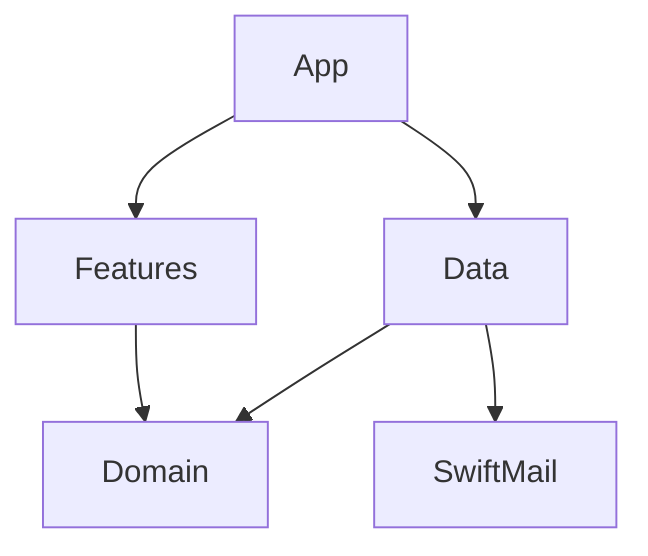

# MailSearch architecture

## Derive, do not own

The design follows MinMaxCal and AgentIDE’s documentation-first approach,
compiler-enforced boundaries, injected ports and changed-state publication.
The menu bar and Settings scene follow MinMaxCal. No calendar, takeover or agent-session behaviour is imported.
Servers own content and Mail owns account setup. MailSearch requests bounded text previews directly from IMAP.
Only enabled-account choices and connection overrides persist in defaults.
Credentials live exclusively in Keychain, keyed by account and connection.
Search text, message metadata and account discovery snapshots stay in memory.

## Targets and ports

- Domain: Foundation-only Sendable values, identity, query validation,
  bounded search rules and the narrow `MailAccountSource`,
  `MailSearchClient`, `MailMessageFlagger`, `MailMessagePreviewer`, `CredentialStore` and
  `SettingsStore` ports. No I/O.
- Data: Mail automation, Keychain, settings and SwiftMail adapters.
- Features: MainActor observable models and native SwiftUI controls,
  depending only on Domain. Shared result and account-status views.
- App: dependency composition, a window-style MenuBarExtra and Settings.

Swift 6 mode and complete concurrency checking apply to every application
target. UI targets use MainActor default isolation. Automation and
Keychain use actors, keeping synchronous system calls off the UI actor.
Each search owns independent IMAP connections. No unchecked Sendable
conformances in application code. SwiftMail owns its network isolation.

## Search lifecycle

An explicit submission snapshots the query and selected connections. Each account
owns a cancellable task, keyed by account id, with a separate publication token.
The model retains tasks until they drain and schedules at most two, including
cancelled connections.
Replacement work for an account waits for its previous connection to close.
The account status owns the connection snapshot used by searches, previews and
flag changes. Search visibility derives from the submitted query.
Deselecting an account invalidates its token, hides its rows and cancels only its
work; other accounts continue. Re-enabling queues that account using the submitted
query, never unsent edits in the search field. New submissions and Stop invalidate
all running tokens. Every callback checks the account token before publishing.
Search connections close on completion or cancellation. Dismissing the menu bar
panel cancels only its preview, so credential dialogs do not cancel the operation
that requested them. Library calls have bounded deadlines. No replacement
connections accumulate beyond the shared limit.

An account connects with verified TLS, authenticates, lists server
mailboxes, then uses EXAMINE. A stable partition searches iCloud Archive and
Gmail All Mail last, matching special-use attributes or standard names.
Non-selectable hierarchy containers are skipped;
their selectable children remain in scope. Only meaningful limits and failures
produce notices, rather than routine protocol and container diagnostics.
UIDVALIDITY and UIDNEXT must be non-zero. Normally the response must confirm
read-only. A host transcript from `imap.mail.me.com` instead returned
`OK [READ-WRITE] EXAMINE completed`. This contradicts
[RFC 3501 §6.3.2](https://www.rfc-editor.org/rfc/rfc3501#section-6.3.2).
Only recognised iCloud connection hosts tolerate that response. Search and preview
still issue EXAMINE and non-marking fetches; their
command allowlists prohibit mutation regardless of the reported selection mode.
Missing UID metadata remains an error with its own diagnostic. Other providers
still require read-only confirmation. No SELECT fallback is used.
UID SEARCH TEXT, optionally combined with FLAGGED, operates on explicit
UID ranges from 1 to UIDNEXT − 1. FLAGGED alone needs no text.
Search responses are filtered to that range, avoiding IMAP’s reversed
range behaviour for nonexistent UIDs. Only matching UIDs are fetched,
50 at a time, requesting flags, internal date and BODY.PEEK of just the
Subject, From, Date and Message-ID headers. Searches expose no body or attachment fetch.
Missing metadata is incomplete, never a claim of no matches.
Mailbox failures remain visible and other mailboxes/accounts continue.
Connection or authentication failure ends only that account.

Limits: two active accounts, one command each, 50 metadata items per
batch, 10,000 UIDs per search window, 2,000 displayed matches per account,
500 selectable mailboxes and 2,000 windows per account. Every exhausted
budget produces an explicit incomplete outcome. UIDNEXT bounds a snapshot,
not a date horizon. Server changes during search can cause omissions;
submit again for a fresh snapshot.

The result accumulator deduplicates only the exact account, mailbox, UIDVALIDITY
and UID tuple. Message-ID is retained for copied diagnostics, not as a merge key. Every arriving
batch re-sorts all displayed rows by descending date, with identity as a stable
tie-breaker. Selection remains keyed to message location.

Recent complete account/query results use an eight-entry, five-minute memory
cache with a 16 MiB estimated metadata budget. Keys include the entire credential
scope and submitted query, including Flagged. Cached rows are explicitly labelled
while an explicit search refreshes them. The first fresh batch replaces that
account's cached rows; a successful empty search removes them too. Errors and
cancellation retain a cache label. Incomplete searches never populate the cache.
Account edits and flag attempts invalidate caches, and a generation guard stops
older searches refilling them after invalidation. There is no persistent index,
mail storage, background refresh or timer. Cache expiry is checked on access.

## Explicit flagging

A separate `MailMessageFlagger` port sets or clears `\Flagged` at one selected location.
The model permits one flag operation at a time, independently of the two search
connections. It snapshots the connection used by the search, so editing an
account cannot redirect a previously displayed UID to another server.
The adapter authenticates a separate short-lived connection, SELECTs the exact
mailbox, checks UIDVALIDITY and persistent flag support, then fetches only UID
and FLAGS to verify the message still exists. Only then does it issue
`UID STORE <uid> +FLAGS (\Flagged)` or `-FLAGS (\Flagged)` and read back the flags for confirmation.
The server must explicitly advertise `\Flagged` in PERMANENTFLAGS. The
library represents both omitted and empty PERMANENTFLAGS as an empty list;
flagging conservatively refuses both, even though the protocol permits all
flags when that response is omitted.
Existing flags, including `\Seen`, are never replaced. No CLOSE or EXPUNGE is
sent. A tracked SwiftMail command captures the server's FLAGS response and
tagged completion using its existing STORE encoder and FETCH parser. If
unflagging removes a Gmail message from Starred before read-back, that
confirmed response proves the change; disappearance alone never does.
Ordinary STORE has the required mutation semantics ([RFC 9051](https://www.rfc-editor.org/rfc/rfc9051.html#section-6.4.6)).
Search and selection never invoke this port. A late flag completion cannot
update a replacement search, and failures never optimistically mark a row.
An interrupted write is reported as unconfirmed, with a fresh search advised.
Mail observes the server flag through its own synchronisation. The app neither
polls nor assigns Mail-specific flag colours.

## Mail integration

The installed `/System/Applications/Mail.app/Contents/Resources/Mail.sdef`
was inspected on macOS 27. It exposes account id, name, email addresses,
type, username, server, port and SSL, with a write-only password property.
No private account store or database is read. Mail is contacted only for account discovery.

The discovery script avoids terminology collisions such as `kind`, which
AppleScript treats as a property rather than a local variable. Regression
scripts run with synthetic records under `using terms from`, never sending
account queries to Mail. Tests serialise AppleScript execution on one actor.

Static AppleScript runs inside the automation adapter without message arguments. Discovery
reads each property separately, retaining available fields and reporting
unavailable field names and numeric errors without raw diagnostics. Missing
connection fields do not prevent configuration of an identified IMAP account.
The adapter discards raw scripting diagnostics and retains only the numeric
error code in a Sendable domain failure. Discovery preserves that
failure through the view model. Permission denial (−1743), timeout (−1712),
privilege failure (−10004) and unavailable Mail have distinct guidance;
unknown errors retain their code without claiming permission was denied.
Error meanings follow Apple's [AppleScript error reference](https://developer.apple.com/library/archive/documentation/AppleScript/Conceptual/AppleScriptLangGuide/reference/ASLR_error_codes.html).
The message-opening adapter, port and AppleScript have been removed. Result
interaction never sends Apple events, traverses Mail mailboxes or invokes a
message URL. IMAP preview identity remains the full account/mailbox/UIDVALIDITY/UID.

## Authentication and sandbox

Discovery is not authentication. Password/app-password login is the first
working path. A shared SwiftMail extension prefers advertised AUTHENTICATE PLAIN
and its SASL-IR support, otherwise using LOGIN unless LOGINDISABLED is advertised.
It never retries rejected credentials with another mechanism. A shared adapter
method connects and authenticates searches, previews, flag changes and Save
verification, preserving cancellation checks between stages. All application
connections require verified implicit TLS 1.2 or later before either method
sends a password. Legacy STARTTLS settings are retained for decoding but
rejected before reading credentials or connecting. Editing one proposes
port 993 and requires a newly entered password and successful verification
before saving; there is no plaintext fallback.
Credentials are scoped to Mail account id, hostname, port,
TLS mode and username, so changing a server never silently sends an old
password to the new destination. A single local, non-synchronised Keychain item
stores the password dictionary; connection keys remain distinct inside it.
The UI never reads an existing password back into a text field. Explicitly
saving a username correction can copy the current Keychain secret to the new
username only when host, port and TLS mode are unchanged. The sheet explains
this reuse; credentials never follow a changed server automatically.
Recognised Gmail accounts use app passwords and iCloud uses app-specific passwords, following
the user's choice not to register an OAuth application. Provider detection
fills missing settings and replaces unusable numeric or alias-style iCloud
usernames with an exposed native iCloud address, using the public IMAP endpoint.
iCloud discovery always defaults to the public endpoint with TLS on port 993,
including when Mail reports another transport. Both providers fix the public
endpoint to TLS on port 993, even for older saved
overrides, retaining the edited username. Other providers remain editable.
Saving trims surrounding username whitespace and iCloud app-specific password
whitespace, preserving its hyphens; generic provider passwords remain untouched.
The Connect sheet links to each provider's password-creation page, with
fixed endpoints for Gmail/iCloud and editable fields for other providers.
Save verifies the draft login first; failed verification never stores it.
Refresh checks credential metadata in Keychain
without requesting password data or allowing authentication UI. Saving a
password does not read the secret back. Explicit searches, previews, flag changes,
username corrections and credential edits may unlock the shared item.
Its binary property list contains the connection-key/password dictionary;
`kSecAttrGeneric` holds only connection keys for metadata-only presence checks.
The credential actor serialises access and caches the whole dictionary or a
failed read for this launch. Concurrent accounts therefore share one read and
one denial. Saving credentials explicitly retries a denied read; otherwise quit
and reopen to retry. Edits preserve other accounts and update the cache only
after the Keychain write succeeds. There are no unlock or forget buttons.
Build 5 uses service `com.mikemcquaid.MailSearch.credentials`, account
`imap-passwords-v1`. Earlier per-password items are neither accessed nor deleted:
users re-enter app passwords once, avoiding separate legacy authorisation prompts.
The app never changes Keychain ACLs or stores the dictionary outside Keychain.
The app discovers metadata once on launch
and on explicit refresh, never polling.
No OAuth flow is presented as available. Internet Accounts and Mail
credentials are not extracted, and Sign in with Apple is not mail access.

Save uses the injected search client's narrow verification method with the draft
connection and normalised password before writing settings or credentials.
Blank input may use the previous saved password only on the same server, port
and TLS mode. Verification connects over verified TLS, authenticates, refreshes
capabilities as required by SwiftMail and disconnects; it performs no mailbox
commands. One save task runs at a time, forwards cancellation and drains before
another starts. Editing is disabled while saving. Dismissing the sheet cancels
verification; failed or cancelled authentication performs no write.

App Sandbox remains enabled. Entitlements grant network client access,
Hardened Runtime Apple events and a temporary Apple-event exception for
`com.apple.mail`. Mail only publishes an access group for composition,
not account/message reads, so `scripting-targets` alone is insufficient.
`NSAppleEventsUsageDescription` explains account discovery; TCC approval
is separate from sandbox entitlement. Denial is actionable in the UI.
An ad hoc local build is runnable but is not a notarised distribution. Its
designated requirement is a code hash, so a changed build cannot inherit the
old build's Keychain authorisation. The build accepts a persistent signing
identity and reports the ad hoc limitation explicitly when none is supplied.
It never weakens Keychain access controls or changes the login keychain password.

## Dependency decision

[SwiftMail 1.13.0](https://github.com/Cocoanetics/SwiftMail/tree/1.13.0)
(BSD-2-Clause) is pinned, using Apple’s
[swift-nio-imap](https://github.com/apple/swift-nio-imap) parser.
A tracked transport patch replaces SwiftNIO SSL with Apple’s
[SwiftNIO Transport Services](https://github.com/apple/swift-nio-transport-services),
which uses Network.framework for connections and system TLS. No BoringSSL
or OpenSSL library is linked or resolved. System trust and hostname checks
remain enabled, with a TLS 1.2 minimum and a ten-second connection deadline.
STARTTLS, SMTP, Outlook MSG/RTF import and EML export sources are excluded.
The latter file formats have no role in server search or bounded previews;
their exclusion requires no extra upstream source patch. SwiftMail’s upstream
Swift 5 language mode is retained; application targets remain in Swift 6 mode.
Its command protocol explicitly requires `SendableMetatype` for commands
crossing executors under Swift 6.4. Thread Sanitizer also exposed an unlocked
command-completion read after rejected PLAIN authentication. The patch uses
the handler's existing lock for that read as well as its writes; the parallel
rejected-login fixtures cover it. Warnings in the patched target are errors.
It was selected after inspecting its EXAMINE, SEARCH, FETCH, timeout and
transport implementations. Using NIOIMAP directly would require owning
connection state, SASL and command routing; libcurl exposes IMAP commands
but leaves structured response parsing to the application. SwiftMail
avoids both a handwritten parser and those extra layers.

Tradeoffs: a young, broad library includes APIs the app never uses,
transitive dependencies and some internal unchecked concurrency code.
Its synchronous command queue drains an active command before disconnect,
so cancellation can wait for the command deadline (SEARCH: 60 seconds,
LIST/EXAMINE: 30, metadata FETCH: 10). These are library limits, not silent
UI success. A cancelled search publishes no new results while draining.
SwiftMail trims mailbox names when resolving namespaces. Names with outer
whitespace or replacement characters are explicitly excluded and mark the
account incomplete, preventing a request from silently targeting another
folder. A namespace fixture pins this dependency limitation.
No IDLE or auto-sync API is used. The only mutation is explicit flagging.
Capabilities gate optional ESEARCH automatically. `X-GM-EXT-1` switches text
queries to a quoted Gmail phrase through `X-GM-RAW`; standard TEXT remains the
fallback. `SearchQuery` keeps the input literal and derives the Gmail phrase.
Double quotes and backslashes in the input force standard TEXT, avoiding
undocumented Gmail escaping. Gmail operators are not exposed as query syntax.
No public
iCloud-specific search extension was found; advertised standard extensions
remain applicable. Equivalent phrase intent still has provider-specific matching.
SwiftMail 1.13.0 exposes Gmail metadata but no Gmail raw-search command.
Small, tracked extensions add Gmail search, password-method selection and flag-change confirmation to
its pinned source. They use NIOIMAP's typed encoders and SwiftMail's existing
parsers, connection and deadlines, rather than a new protocol parser.
`script/prepare` extracts SwiftMail's exact revision from
`vendor/SwiftMail/upstream.json`, applies the transport patch and adds the
extensions to generated, ignored sources under `vendor/SwiftMail/Sources`.
The small local package manifest omits SwiftNIO SSL and unused SMTP/example
dependencies entirely, rather than merely avoiding their APIs at runtime.
Other packages stay locked in `Package.resolved`. Preparation reapplies
patches after cache resets and writes only changed files. Updating SwiftMail
requires reviewing the manifest, transport patch and extensions against the
new upstream source. This maintenance cost is the tradeoff for retaining
SwiftMail's parser and command handling while using Apple's TLS stack.
See [vendor/README.md](vendor/README.md) for the patch and update procedure.

The pinned SwiftNIO uses a checked continuation for `EventLoopFuture.get()`.
A concurrent completion test reproduces Swift 6.4's Thread Sanitizer race
between unsafe continuation resumption and reuse of task storage. The
checked bridge avoids that path and validates exactly-once resumption,
with the same value, error and cancellation behaviour. Sanitizer checks
remain enabled; the small allocation cost is acceptable for network I/O.

The pinned SwiftNIO IMAP also receives a one-line empty-Base64 guard.
Sanitizer runs exposed concurrent writes to Swift's shared empty-array
storage when it used `unsafeUninitializedCapacity: 0` to describe empty
SASL challenges. Returning an empty array directly avoids that path. The
existing parallel AUTHENTICATE PLAIN fixtures cover the regression under
Thread Sanitizer. `script/prepare` checks the exact upstream revision and
applies the tracked patch idempotently; no sanitizer report is suppressed.

All Swift Logging output is disabled before constructing SwiftMail,
including protocol and error logs that could contain private content.
App errors are fixed messages, never raw server/AppleScript diagnostics.
Parser buffers and literal/body/attribute limits bound malformed input.
Headers render as plain text and never load remote content.

## Checks

XcodeGen generates the application project from `project.yml`, depending
on the local Swift package products. The app keeps its sandbox and hardened
runtime entitlements. `script/version` derives the marketing version from
the nearest reachable bare version tag, defaulting to `0.0.0`, and counts
`origin/main` commits for the build number, falling back to `main` or `HEAD`.
The generated version settings are shared by scripted and Xcode builds.
Scripted app builds default to Release, with `XCODE_CONFIGURATION` overrides.
The app enables dead code stripping, user script sandboxing and generated
asset and string catalogue symbols. The explicit `arm64` architecture keeps
app builds limited to Apple silicon. There are no Run Script build phases;
version generation is a scheme pre-action.

`script/build` creates the sandboxed app. `script/install` builds, quits the
previous app, replaces /Applications/MailSearch.app and launches the installed
bundle through LaunchServices. `script/test` runs pure rules,
model fakes and a loopback-only IMAP fixture, with no Mail or real Keychain
access. TLS fixtures generate short-lived synthetic certificates with the
system `openssl` tool, scoped to temporary directories. Connection-specific
roots are used only by tests, with full hostname and expiry checks; no test
installs certificates or changes Keychain trust. Tests cover trusted TLS,
untrusted roots, expired certificates, wrong hostnames, stalled handshakes
and Gmail/iCloud search behaviour over TLS. The stalled-handshake fixture confirms
TLS has started before cancellation and measures socket closure on the server,
excluding test-task scheduling delays from the connection deadline assertion.
`script/style` enables every SwiftFormat and SwiftLint lint rule, then documents
conflicts in the configuration and narrow domain exceptions beside the code.
MinMaxCal's configured trailing commas and modifier order take precedence over
AgentIDE's disabled checks. AgentIDE's cohesive helper files, internal defaults
and lifecycle ordering are retained where splitting them would obscure ownership.
Tests allow literal fixture numbers. Protocol limits, Apple-event bridging and
native layout values have explicitly scoped exceptions; there is no baseline.
ShellCheck, shfmt, actionlint and zizmor also run. The README is limited to
five Features bullets and 100 lines after wrapping at 80 columns, including
blank lines, both locally and in CI.
`script/analyze` checks dependency/import and read-only API boundaries,
then builds with warnings as errors and runs SwiftLint analysis and Periphery.
Both passes run even if one fails, and either failure makes analysis fail.
The build uses a freshly removed `.build/analyze` directory, captures verbose
compiler invocations and exports the package description, avoiding Periphery's
nested manifest sandbox inside Sandvault. SwiftLint's skipped-file diagnostics
are failures, not a clean result. Analysis uses SwiftPM's native build engine
to regenerate the index for all app and test targets, with manifest caching
disabled so new dependency extension files are included. The installed Swift
Build engine left stale index entries after incremental builds. The native engine is
deprecated but available in this toolchain; release builds and tests use
the default engine. Generated SwiftMail sources are treated as an external
dependency; application and test targets must have no analyser findings.
Sandbox app, test and analysis builds run at nice level 10 with at most six jobs.
Dependency preparation resolves and patches the selected scratch directory,
including the isolated Address and Thread Sanitizer directories. CI keeps
per-target logs and JUnit reports, uploads failure diagnostics and fails if any
target or sanitizer fails. Neither sanitizer uses suppressions or skipped tests.
Address Sanitizer retains Release: the pinned SwiftSoup HTML parser exhausts a
concurrency worker's stack with Debug instrumentation, even on the small preview
fixture. Normal tests and Thread Sanitizer remain Debug. See `vendor/README.md`.
The analysis build loads Xcode 27's Testing macros through its external plugin
server: the in-process server crashes inside SourceKit. The real compiler log
records this setting for SwiftLint, with the same macros and no excluded tests.
Sandbox builds also pass the frontend sandbox flag explicitly for SourceKit's
macro subprocesses. Missing or partial analysis still fails the gate.
Host acceptance checks are tracked separately in `HOST-CHECKS.md`.

The public repository follows the reference apps' README structure. Detailed
query behaviour lives in `SEARCH.md`, contribution guidance in
`CONTRIBUTING.md` and distribution setup in `RELEASING.md`. GitHub Actions
runs independent style, test and analysis jobs. Normal CI builds and uploads
an ad hoc signed app ZIP without signing secrets or notarisation.
Test, analysis and release jobs cache dependency downloads, keyed by the
lockfile and SwiftMail pin. Build output and signing material are not cached.
Developer ID signing, notarisation and releases run only on manual dispatch.
The Release workflow accepts a manual run from `main` with a bare version,
tags locally before building, signs and notarises, then requires startup checks
on macOS 26 and 27 before pushing the tag and publishing the release. Pushes
changing `.github/workflows/release.yml` trigger a dry run with a local
`9999.0.0` tag and ad hoc signing, skipping notarisation and publishing.
Missing or incomplete signing credentials fail the release.
No email credentials are available to CI. Dependency updates are proposed
through Dependabot.
App bundles include the project licence and generated dependency notices.
Release tags identify the project source, dependency pins and tracked patches
required to reproduce each build.

## Native presentation and icons

An LSUIElement app exposes a 420-point-wide window-style MenuBarExtra like MinMaxCal,
with a monochrome template envelope and search lens matching the app icon.
The vector asset adapts to menu bar appearance and separates the overlapping
lens with a transparent gap for readability at 20 × 18 points. Opening Settings
hides the active panel before bringing the Settings scene forward.
A native Settings scene has Accounts and About tabs. About receives the running
app's explicitly loaded bundled icon and version from App, keeping bundle
access out of Features and avoiding the default NSApplication icon cache.
Accounts explicitly identifies Mail.app as the source of discovered metadata
and explains that server searches use separate credentials.
The search panel starts with a mode-specific search placeholder, account selection
and compact Mail-style actions. Results use tight row insets and show a flag icon
only when flagged. Settings and Quit share the bottom status row, using the same
exit symbol as MinMaxCal. There is no repeated app icon or title inside the panel.
Explicit operations may finish while the panel is hidden;
an idle menu bar does no polling.
Liquid Glass is reserved for controls; results retain a readable content surface.
Native controls respect system contrast, transparency and motion settings.
`App/Icons/AppIcon.icon` contains a flat SVG envelope and amber search lens on
a solid teal tile, with dark and tinted specialisations, following MinMaxCal's
Icon Composer packaging. `actool` compiles it during `script/build`.
About loads the resulting AppIcon.icns directly. The design notes are
retained beside the icon source.
The accounts list shows the IMAP login only when it differs from the displayed
addresses, omitting endpoint and saved-password status lines. Failed search
details include the login and endpoint. Search diagnostics retain the connection
snapshot used by that submission, even after Settings is edited. Detail text is
rendered in a non-editable, selectable NSTextView through NSViewRepresentable.
The text view handles ⌘C and ⌘A directly for the menu bar panel, has no rich text
or remote content and preserves selection when unchanged text is republished.
SwiftUI measures and owns its frame. AppKit’s automatic resizing is disabled so
scroll bar width changes cannot move the text outside its host.
The result context menu can copy
message metadata through an App-injected pasteboard closure.
No passwords or tokens are copied.

## On-demand previews

`MailMessagePreviewer` returns Sendable text and a truncation marker. One preview
connection at a time EXAMINEs the original mailbox, verifies UIDVALIDITY and UID,
then reads BODYSTRUCTURE and at most 32 KiB of a non-attachment text part using
bounded BODY.PEEK ranges. SwiftMail handles MIME structure and transfer decoding.
Plain text is preferred; [SwiftSoup 2.13.9](https://github.com/scinfu/SwiftSoup/tree/2.13.9) (MIT)
converts HTML-only content to text without
executing scripts or fetching resources. No WebView or HTML attributed-string
importer is used. Preview text stays in a separate eight-entry, five-minute memory
cache keyed by full message location and connection. The visible preview clears
on selection change or another click on its row; Return and Space also toggle it.
Rows are plain native SwiftUI buttons in a lazy stack, with one scroll target per
message and its divider drawn as an overlay. A single
[ScrollPosition](https://developer.apple.com/documentation/swiftui/scrollposition)
tracks visible message identity as incoming batches re-sort. Preview expansion,
height changes and keyboard navigation update that same position.
When loading finishes, a preview-height change scrolls its header into view so
newly loaded text does not grow below the visible area.
This replaces native List selection and tap recognisers, whose lazy row estimates
could leave a loaded preview outside the visible area even after scrollTo.
Selection changes only dismiss a different preview; click, Return, Space and the
Preview toolbar button operate independently of ongoing searches. Arrow keys
move selection and scroll it into view. The context menu flags or copies the
specific clicked result. Native view tests verify visible preview text while a
held search publishes successive batches of 100 newer results, both during and
after preview loading, with short and long previews and always-visible scroll
bars. Tests set the scroll view’s style without changing system preferences.
Tests initialise AppKit before hosting the app's fixed panel dimensions in a
visible window, laying out both the window and hosting view. They wait for
rendered, visible text with a bounded deadline, rather than assuming SwiftUI has
finished updating when the preview task completes.
The parser is maintained and handles malformed HTML and entities without
introducing a browser engine or a handwritten markup parser.
New selections cancel and drain prior previews, and generation checks reject
late replies. Search, flagging and preview have separate busy states. There are at
most five IMAP connections: two search accounts, one preview, one flag write and
one Save verification. Preview text expands directly below the selected
row's existing header within the results list. There is no split view or repeated
message header. Gmail namespace prefixes are hidden only for display; full
mailbox paths remain in all identities, commands and copied message details.

Gmail flagged searches prefer the server-advertised special-use Starred mailbox.
If none is selectable, the normal all-mailbox FLAGGED search remains available.
The Gmail app-password link passes an email account hint, which the browser may
ignore; it never supplies a password or OAuth token. iCloud guidance distinguishes
primary mail usernames from aliases and numeric Mail account identifiers.
