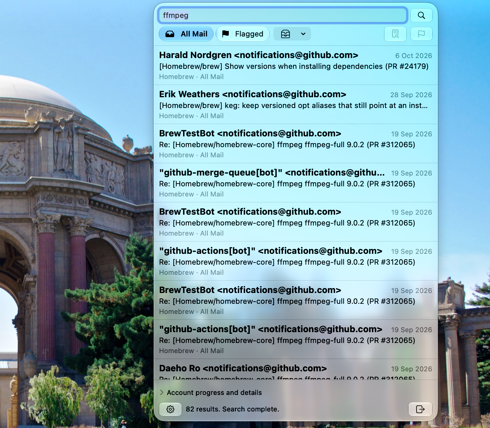

# ✉️ MailSearch

MailSearch is a native macOS menu bar app for searching email directly
on IMAP servers. It discovers accounts from Mail.app, shows results from
each server as they arrive and lets you preview, flag and unflag messages.



## 💡 Motivation

Find mail across accounts and folders without waiting for a local index
or keeping another email client open. Mail owns account setup, servers
own messages and MailSearch keeps only bounded, temporary results.

## ✨ Features

- Discover accounts through Mail's public scripting interface and
  refresh them when your setup changes.
- Search selected accounts and every selectable server folder, including
  archived and sent mail, without an implicit date restriction.
- See subject, sender, date, account, folder and flagged status, sorted
  newest first while results arrive. Each account has its own progress
  and errors; a failed account does not stop the others.
- Choose **Flagged** to find starred or flagged mail without a search
  term. Flag or unflag individual messages; Mail sees the change through
  its normal server synchronisation.
- Click a row or press Return or Space to toggle a bounded text preview,
  including during a search. Previews do not mark messages as read or
  load remote content. Arrow keys select results.
- Change account selection during a search to update results and cancel
  only deselected accounts. Stop cancels the current search.
- Reuse recent results and previews from short-lived memory caches.
  Cached results are labelled while a submitted search refreshes them.
- Connect Gmail with an app password and iCloud with an app-specific
  password. Save verifies credentials before storing them in Keychain.
- Use a compact Liquid Glass panel, native keyboard controls, VoiceOver
  and a Settings window with Accounts and About panes.

## 🚫 Out of Scope

- **An email client.** No composition, attachments, rich HTML rendering,
  moving or deleting messages. Search and previews never change flags;
  flagging and unflagging are explicit actions.
- **Opening messages in Mail.** Mail.app supplies account metadata only.
- **Local mail.** “On My Mac” folders, POP and Exchange accounts without
  IMAP cannot be searched. Unsupported accounts remain visible.
- **Background indexing.** No persistent mail index, hosted backend,
  polling, daemon or launch-at-login requirement.
- **Shared authentication.** Mail and Internet Accounts do not provide
  passwords or reusable OAuth tokens. OAuth is not implemented.

## 📋 Requirements

- macOS Tahoe (26) or later. CI builds target Apple silicon.
- IMAP accounts configured in Mail.app, with separate credentials that
  permit IMAP over implicit TLS. Gmail and iCloud use port 993; STARTTLS
  is not supported. Provider policies may restrict app passwords.
- Automation permission to discover accounts from Mail.app.
- To build: Xcode 27 with Swift 6.4 and [Homebrew](https://brew.sh).

## 📦 Installation

Build from source:

```sh
script/bootstrap
script/build
open MailSearch.app
```

Use `script/install` to build and copy the app to /Applications.
No public binary release or Homebrew cask is available yet.

The app uses App Sandbox and Hardened Runtime. Local builds are signed
ad hoc unless `MAILSEARCH_SIGNING_IDENTITY` names a signing certificate.
Use a consistent identity to avoid fresh Keychain authorisation after
rebuilding; see [authentication](AUTHENTICATION.md#keychain-access-and-rebuilds).

## ⚙️ Configuration

Click the envelope in the menu bar. Allow MailSearch under **System
Settings → Privacy & Security → Automation** when prompted, then open
**Settings → Accounts** to connect accounts discovered from Mail.app.

Gmail and iCloud use fixed TLS settings. For iCloud, use the primary
iCloud Mail address or its username, rather than an alias or custom
domain. Other IMAP providers have editable server and port settings,
with implicit TLS required.
See [AUTHENTICATION.md](AUTHENTICATION.md) for setup and troubleshooting.

Enter a plain phrase and press Return or Search. For example,
`project update` requests a whole phrase through standard IMAP `TEXT`
or quoted Gmail `X-GM-RAW` when advertised. Do not add quotes or Gmail
operators. Matching can occur in any header or the body; server search
behaviour differs and attachment-content searching is not guaranteed.
See [SEARCH.md](SEARCH.md) for matching, exclusions and explicit limits.

## 🛠️ Development

- `script/bootstrap`: install Brewfile tools and generate the Xcode project
- `script/build`: build and sign the app; `MailSearch.app` symlinks the output
- `script/install`: build, then copy the app to /Applications
- `script/test`: unit, native view and loopback IMAP integration tests
- `script/style [--fix]`: Swift and shell style, plus workflow checks
- `script/analyze`: dependency boundaries, SwiftLint analysis and Periphery
- `script/zip`: archive the built app with its bundled licence notices
- `script/package`: sign and notarise a distribution using release secrets
- `script/version`: derive the version and build number from Git

Builds use XcodeGen and Xcode, defaulting to Release, with Swift package
targets for the app's layers and tests. Use `XCODE_CONFIGURATION=Debug`
for a debug app build. The nearest reachable version tag names the build,
or `0.0.0` before the first release; the build number counts `main` commits.

CI runs style, tests and analysis independently, including Address and
Thread Sanitizer tests in separate build directories. Both sanitizers halt on
the first finding and block CI on failure. Compiler warnings in app and
test targets are errors. Tests use synthetic data and never access real mail or credentials.
CI caches dependency downloads and uploads an ad hoc signed app ZIP.
Pushes changing `.github/workflows/release.yml` also test app startup.
Developer ID signing, notarisation and releases run only on manual dispatch.
Run the Release workflow from `main` with a bare `MAJOR.MINOR.PATCH` version
to publish automatically after the macOS 26 and 27 startup checks.

See [CONTRIBUTING.md](CONTRIBUTING.md) for development conventions,
[ARCHITECTURE.md](ARCHITECTURE.md) for the design and
[RELEASING.md](RELEASING.md) for CI and distribution setup.

## 🚧 Status

Early development, primarily for Mike McQuaid's workflow. Behaviour and
interfaces may change. iCloud authentication, flagged results and text
search have been confirmed manually. Provider coverage, flag propagation
and live preview interaction still need the GUI checks recorded in
[HOST-CHECKS.md](HOST-CHECKS.md). Protocol fixtures cover both Gmail and
standard IMAP but do not establish support for every live provider.

## 📮 Contact

[Mike McQuaid](mailto:mike@mikemcquaid.com). Report vulnerabilities privately
as described in [SECURITY.md](SECURITY.md).

## 📄 Licence

Copyright © 2026 Mike McQuaid. Licensed under [AGPLv3](LICENSE).
Third-party dependencies retain their own licences; see
[THIRD-PARTY-NOTICES.txt](THIRD-PARTY-NOTICES.txt).
